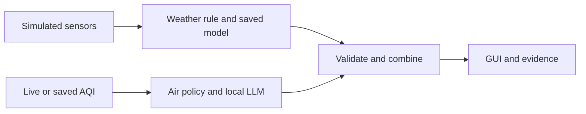
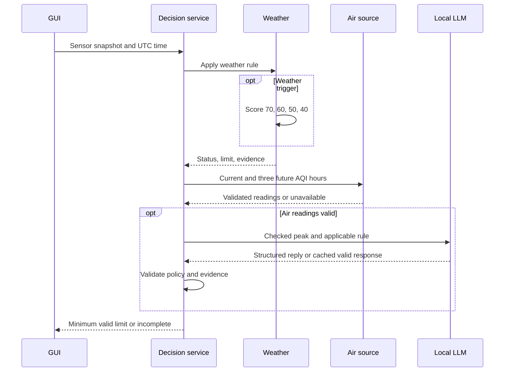
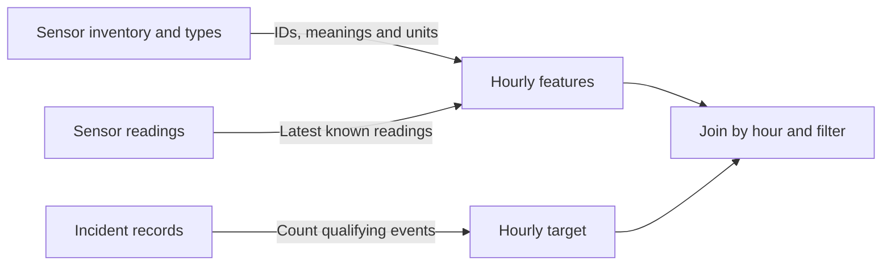

  

    <h1>SpeedLimit</h1>
    
Speed recommendations from weather and air quality

    
Mario Palagyi &amp; Jerome Puthuparampil

  

Local speed limit setting website prototype that lets operators automatically or manually adjust speed limit based on weather and air conditions

Classroom prototype01 / 07

---
layout: default
class: sl-deck
---

# Project and approach

<h2>Stakeholders</h2>

Drivers and passengers, road operators, traffic authorities, emergency services, nearby residents, environmental agencies, data and sensor experts, software engineers, and legal specialists.

<h2 style="margin-top:28px">Three-step exercise process</h2>

We completed the exercises through manual work, an initial AI prompt, and a refined prompt, following the process defined in class.

<h2 style="margin-top:28px">AI use and lessons learned</h2>

<ul>
  <li>We mainly present the initial-prompt outputs because we judged them the most useful for this prototype.</li>
  <li>With GPT 6.1 Sol, more elaborate prompts sometimes added complexity without improving the result.</li>
  <li>Some manual and initial-prompt solutions were similar. We kept the classroom prototype simple where more complexity didn't offer any benefit.</li>
</ul>

AI model: GPT 6.1 Sol · Scope: classroom prototype02 / 07

---

# Training and operation

<strong class="sl-accent">Training:</strong> clean historical records, align hours, train and save the weather model.

<strong class="sl-accent">Production:</strong> different steps depending on weather or air branch, validate and combine, then decision in GUI

Weather branch invokes only on trigger of condition · Air runs independently03 / 07

---
layout: default
class: sl-deck
---

Data engineering

<h1>Data quality shaped the model</h1>

  

    
405 / 744

    
<strong>usable Year N hours</strong>

    

      Inputs at hour start: 
      light, water, temperature, 
      recorded speed limit.
    

    

      <strong>Target:</strong> near-accidents 
      in the following hour.
    

  

  

    

      <strong class="sl-accent">Sensor meaning</strong> 
      Resolve ambiguous sensor identities.
      
        IDs 15/18 provisionally represent temperature.
        ID 16 is ambiguous; ID 19 has no inventory entry.
        Both are excluded from model inputs.
      
    

    

      <strong class="sl-accent">Event timing</strong> 
      Set aside events with unresolved times.
      
        44 events use hour 24, including event-file row 74.
        Incidents use hours 1–24; sensors use 0–23.
        The full hour convention remains unresolved.
      
    

    

      <strong class="sl-accent">Time alignment</strong> 
      Use past readings; exclude speed-changing hours.
      
        A 09:50 reading can supply the 10:00 example.
        One speed per hour simplifies reality and loses data.
        Further engineering could model shorter intervals after
        timestamp clarification.
      
    

  

Provisional assumptions: temperature IDs, event-hour interpretation, and complete event logs for zero-event hours.

Raw CSVs stay unchanged · Cleaning actions and source checksums are recorded04 / 07

---

Evidence

# Demonstration and measured results

  

    
Clear

    
80

    
km/h

  

  

    
Black Ice

    
70

    
km/h

  

  

    
Dark

    
40

    
km/h

  

  

    
Poor air forecast

    
50

    
km/h

  

  

    
Both

    
40

    
km/h

  

<strong class="sl-accent">64 automated tests passed</strong> and five recorded real-model checks passed.

| Evaluation dataset | Network MAE | Baseline MAE |
|---|---:|---:|
| Year N test | **0.86** | 0.91 |
| Year N+1 | 0.91 | **0.89** |

MAE: average absolute prediction error, measured in near-accidents per hourly example. Lower = better

Validation also favored the baseline. Predictive improvement remains limited.

Real-model checks and demos recorded 13 Nov05 / 07

---

Risks and lessons

# Limits that determine the next step

| Limitation | Consequence |
|---|---|
| Data Engineering | Low predictive performance and oversimplified data engineering, leading to information loss, highlighting this step's importance. |
| No training hours at 40 km/h | The dark-road fallback has weak support. Every candidate misses the target in that example. |
| Year N+1 repeats sensor readings | Following-year results provide limited independent evidence. |
| LLM made numerical policy errors | Python supplies the checked peak and applicable rule, then validates the response. |

<strong>Historical associations do not establish the safety effect of changing speed limit.</strong>

The AQI-to-speed mapping is an educated assumption. Validation further needed

Target unmet and unsupported-speed warnings remain visible in the GUI06 / 07

---

Recommendation

# Continue controlled validation

<ol class="sl-next">
  <li><strong class="sl-accent">Clarify data definitions</strong> Confirm sensors (e.g. T, and IDs), event times, and logging coverage (0 accidents recorded hours).</li>
  <li><strong class="sl-accent">Strengthen the model evidence</strong> Collect observations at reduced speeds (40 km/h) and compare simpler models.</li>
  <li><strong class="sl-accent">Validate the operating policy</strong> Human oversight and failure response, then check reliability over time.</li>
</ol>

<strong>Further plans include:</strong> Examine data in detail, fix excluded data thus better model performance, human oversight

Thank you! - Technical backup slides follow07 / 07

---

Backup A · Sequence

# One timestamped decision

Logical independence · Sequential execution · Both branches required for a new final limitBackup A

---

Backup B · Data audit

# Source-data findings and handling

| Finding | Handling |
|---|---|
| Semicolons, decimal commas, water code `W ` | Explicit parsing, numeric normalization, trimmed codes |
| Headerless N+1 reading file | Assign known columns and preserve the first observation |
| `T` means temperature and traffic | Use IDs 15/18 provisionally and exclude ambiguous ID 16 |
| Unknown ID 19 and missing IDs 7/10/17 | Exclude unknown readings and record inventory discrepancies |
| Hour-24 events: 44 in N, 31 in N+1 | Quarantine invalid dates and plausible affected midnights |
| No event-coverage field | Assume complete logs except known uncertain hours |
| Identifying licence plates | Drop at the ingestion boundary |
| N+1 readings repeat N exactly | Flag limited independence in the assessment |

Actual checked sensor readings had zero exact duplicates, invalid dates, missing numeric IDs/values, or out-of-range values.

Provisional mappings and event-hour semantics still require confirmationBackup B

---

Backup C · Feature engineering

# What one training row means

<strong class="sl-accent">At 10:00:</strong> use weather and posted speed known by 10:00. <strong class="sl-accent">Target:</strong> near-accidents from 10:00 inclusive to 11:00 exclusive.

| Step | Implemented rule |
|---|---|
| Align readings | Latest value at or before the boundary, at most two hours old |
| Combine sensors | Median across available sensors of the same feature |
| Normalize units | Lux multiplied by 1,000 once, water in µm, temperature in °C |
| Count events | One row counts once if any valid near-event measurement exists |
| Distinguish zero and unknown | Zero requires assumed coverage, unknown coverage excludes the hour |
| Keep usable targets | All features present, coverage acceptable, no within-hour speed change |

A 09:50 reading can describe 10:00. A 10:10 reading cannot. The first hour has no past boundary features.

405 usable N hours and 404 N+1 hours · Exclusion categories overlapBackup C

---

Backup D · Weather model

# Model and evaluation

<strong>StandardScaler + MLPRegressor:</strong> four inputs, 16 ReLU hidden units, one count estimate. Chronological 70/15/15 split, training-only scaling, seed 42.

| Partition | Hours | Network MAE | Training-mean baseline MAE |
|---|---:|---:|---:|
| N training | 283 | 0.902 | 0.993 |
| N validation | 61 | 1.190 | 1.104 |
| N test | 61 | 0.860 | 0.910 |
| N+1, frozen model | 404 | 0.907 | 0.888 |

<strong>Training support at 40 / 50 / 60 / 70 / 80:</strong> 0 / 7 / 84 / 15 / 177 hours.

<strong>N+1 verdict: insufficient evidence.</strong> Its sensor inputs repeat N exactly. The original model remains unchanged.

MAE measures average absolute count error in events/hour · No causal intervention testBackup D

---

Backup E · Weather tests

# Strict boundaries and fallback

<code>light &lt; 500 OR (water &gt; 1000 AND temperature &lt; 0)</code> Units: millilux, µm, °C. Clear weather returns 80 without a network call.

| Light | Water | Temp. | Trigger |
|---:|---:|---:|---|
| 499 | 0 | 10 | Yes |
| 500 | 1000 | -1 | No |
| 500 | 1001 | -1 | Yes |
| 500 | 1001 | 0 | No |

| Dark-road candidate | Estimated events/h |
|---|---:|
| 70 km/h | 2.431 |
| 60 km/h | 2.224 |
| 50 km/h | 1.830 |
| 40 km/h | 2.332 |

Choose the highest candidate with estimate ≤1. If none qualifies, choose 40 and display <strong>target unmet</strong>.

The fallback chooses the lowest allowed speed · Scores can be nonmonotonicBackup E

---

Backup F · Air-quality branch

# Air policy and guarded local inference

Take the maximum European AQI across the current reading and next three complete hourly forecasts.

| Peak AQI | Reduction from 80 | Air limit |
|---|---:|---:|
| 0 through 60 | 0 km/h | 80 km/h |
| Above 60 through 80 | 10 km/h | 70 km/h |
| Above 80 through 100 | 20 km/h | 60 km/h |
| Above 100 | 30 km/h | 50 km/h |

<strong class="sl-accent">Python:</strong> verifies peak and selects the applicable rule. <strong class="sl-accent">Qwen:</strong> returns structured fields that Python validates against the rule and evidence.

The GUI derives its sentence from checked fields. It retains original model prose and raw JSON for inspection.

Source: Open-Meteo / CAMS ENSEMBLE · Speed mapping: student assumptionBackup F

---

Backup G · Operational behavior

# Reliability and failure behavior

| Situation | Implemented behavior |
|---|---|
| Both branches valid | Final limit is the minimum, such as min(60,70) = 60 |
| Required branch unavailable | Incomplete, no new final limit, last complete time remains visible |
| Weather target unmet | Lowest candidate with warnings, branch can still be valid |
| Start / Stop | Immediate decision then due ticks / stop future ticks |
| Slow request or GUI redraw | Busy guard avoids overlap, redraw alone causes no decision |
| API freshness | Cache up to 15 minutes, validate again and fail on unsuccessful expired refresh |
| Repeated identical LLM input | Reuse a previously validated response |

Scheduling depends on the active page. Long unattended use and browser sleep/resume still need checks.

“Complete” describes software branch validity · Road-sign failure control remains unimplementedBackup G

---

Backup H · Maintainability

# Architectural change requests

| Proposed change | Components affected | Required work |
|---|---|---|
| Sensors report Fahrenheit | Input adapters and cleaning | Convert to Celsius before routing or inference, test boundary equivalence |
| Only skidding counts | Event target construction, training, evaluation | Rebuild labels in both years, retrain, compare results |
| Electric cars exempt from air restrictions | Vehicle inputs, air policy, combination, display | Preserve weather limits and resolve how vehicle-specific limits reach drivers |

Separate responsibilities make change impact easier to identify. These changes remain proposals.

Current scope: one laptop application, simulated weather inputs, a local weather model, Open-Meteo, and local Ollama.

Core modules: data, weather, air, decision orchestration, GUIBackup H

---

Backup I · Accountability

# AI use and human oversight

  

    <h2>Development and operation</h2>
    
A coding assistant wrote the implementation and tests.

    
The local Qwen model participates in the runtime air branch.

    
Prompt failures and revisions are recorded. The course's required AI-free comparison still needs its own evidence.

  

  

    <h2>Decisions requiring people</h2>
    
<strong>Data owners:</strong> confirm sensor and event definitions.

    
<strong>Traffic specialists:</strong> approve the speed policy and failure procedure.

    
<strong>Engineers and operators:</strong> verify reliability and investigate uncertain results.

  

Safety benefit, deployment readiness, and formal compliance remain unestablished.

Actual provenance and bounded evidence support a defensible discussionBackup I

---
layout: default
class: sl-deck sl-backup sl-tight
---

Backup J · Hour exclusions

# How 744 hours became 405

One example pairs conditions known at hour start with near-accidents during the following hour.

| Preparation step | Newly excluded | Remaining |
|---|---:|---:|
| January: 31 days × 24 hours | — | 744 |
| Require readings available at hour start | 1 | 743 |
| Require interpretable incident coverage | 29 | 714 |
| Exclude hours with changing posted limits | 309 | **405** |

There are 329 speed-changing hours overall.
Twenty already fail the incident-coverage rule, so only 309 are additional exclusions.
The 405 examples are then split into training, validation, and test sets.

<strong class="sl-accent">Why exclude changing speeds?</strong>
An hour with 80 km/h until 10:20 and 60 km/h afterwards cannot be faithfully represented by one speed for the entire hour.

This is a simplifying model choice, not an unavoidable cleaning rule.
It loses data and may introduce selection bias.
Clarifying event times could enable shorter constant-speed intervals with duration-aware targets.

Counts reflect current preparation rules · Timestamp assumptions still need confirmationBackup J

---
layout: default
class: sl-deck sl-backup
---

Backup K · Data relationships

# How the source data connect

<strong class="sl-accent">Sensor mapping:</strong>
the readings' Sensor field matches inventory SensorID.
The inventory's SensorTypeCode connects to the type definitions.

This mapping needs exceptions: T means both temperature and traffic,
sensor 19 lacks an inventory entry, and special sensor −1 records the posted speed limit.

<strong class="sl-accent">Incident relationship:</strong>
events have no sensor-ID link. They connect to sensor-derived features through the constructed hourly timeline.

Incidents use hours 1–24 and sensors use 0–23.
If incidents use an hour-ending convention, all event hours may need realignment.
Quarantining hour 24 alone does not settle this question.

Four feature values and one incident-count target per eligible hourBackup K

---
layout: default
class: sl-deck sl-backup sl-tight
---

Backup L · Feature selection

# Model inputs and excluded fields

| Weather-model input | Role |
|---|---|
| Light, in millilux | Represents lighting conditions |
| Road water, in µm | Represents water on the road |
| Temperature, in °C | Represents temperature and freezing conditions |
| Posted speed limit, in km/h | Allows predictions at different candidate limits |

<strong class="sl-accent">Target:</strong>
qualifying near-accidents in the following hour.
The data contain no labels identifying the optimal speed.

<strong>Other channels:</strong>
humidity, wind, noise, and air pressure are outside the selected prototype feature set.
This does not establish that they are irrelevant.
Traffic cannot be confidently identified from the duplicated T code.

<strong>Unclear sensors:</strong>
ID 16 has ambiguous meaning and ID 19 lacks an inventory entry.
Temperature IDs 15/18 remain provisional.

<strong>Event fields:</strong>
close-car, guardrail, and skid measurements construct the target rather than becoming inputs.
Damage or injury alone does not qualify for this target.
Licence plates are discarded.

<strong>Separate or unavailable information:</strong>
AQI belongs to the air branch.
Future readings and incident outcomes cannot be prediction inputs because they would leak future information.

Four inputs · One predicted count · Additional features require further evaluationBackup L

