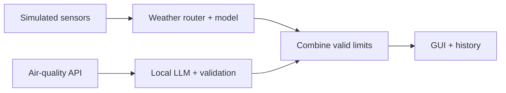
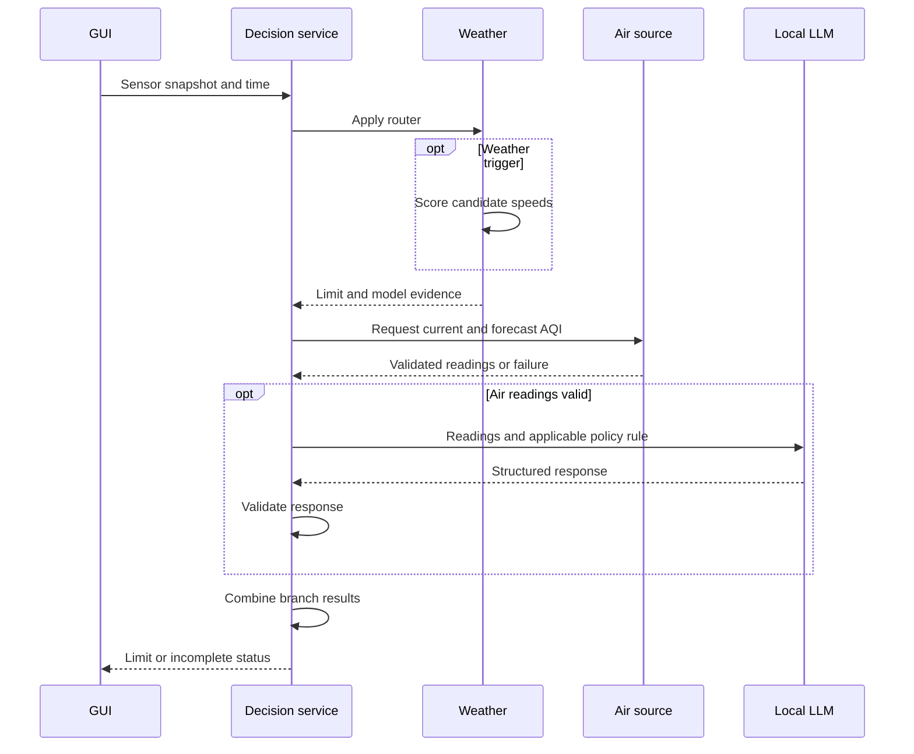

Software Engineering in AI · Management briefing

  

    
SpeedLimit

    

      Adapting a road’s speed limit to weather and air quality
    

    

      Mario Palagyi &amp; Jerome Puthuparampil
    

  

  

    

      80
    

    

      Starting limit · km/h
    

  

---
layout: default
class: bg-stone-50 text-slate-900
---

01 / Stakeholders and requirements

# Who needs what from SpeedLimit?

  

    
People affected

    

      <b>Road authorities</b> approve the policy.  
      <b>Operators</b> need clear decisions and failure alerts.  
      <b>Drivers and the public</b> bear the consequences of unsafe or inconsistent limits.
    

  

  

    
Quality priorities

    

      <b>Reliability</b> — show incomplete decisions when a required source fails.  
      <b>Traceability</b> — retain inputs, timestamps and branch reasons.  
      <b>Maintainability</b> — separate data, models, rules and display.
    

  

Engineers maintain the system. Data owners clarify records. Regulators assess deployment obligations.

---
layout: default
class: bg-stone-50 text-slate-900
---

02 / Architecture and working MVP

# Training and operation

Training on historical records

Each production decision

The weather model runs only on a trigger. Air quality runs independently.
The lower valid limit becomes the recommendation.

---
layout: default
class: bg-stone-50 text-slate-900
---

03 / Features, cleaning and imputation

# Data choices shaped the model

  

    
405 / 744

    
usable Year N hours

    

      <b>Inputs</b> 
      Light, road water, temperature and the recorded speed limit at the hour’s start.
    

    

      <b>Target</b> 
      Near-accidents in the following hour.
    

  

  

    
Cleaning

    

      Resolve ambiguous sensors, convert lux to millilux and exclude unclear event times.
      Drop licence plates.
    

    
Imputation

    

      Carry earlier readings forward for up to two hours.
      Take the median across working sensors.
    

    
Evaluation

    

      Exclude hours with changing limits. Split hours chronologically and fit preprocessing on training data.
    

  

Provisional assumptions include temperature sensor IDs and complete event coverage for zero-event hours.

---
layout: default
class: bg-slate-900 text-white
---

04 / Demonstration and test evidence

# What did the prototype demonstrate?

  

    
{{ item.label }}

    

      {{ item.speed }}
    

    
km/h

  

  

    <b class="text-amber-300">64 automated tests + 5 real-model checks</b> 
    Checks covered boundaries, failures and branch combination.
    Automated API/LLM tests used prepared responses.
  

  

    <b class="text-amber-300">Test error of 0.86 incidents/hour</b> 
    A constant estimate scored 0.91.
    The constant estimate performed better the following year.
  

In darkness, every speed missed the target. The fallback at 40 estimated 2.33 events/hour,
with zero usable training hours at that speed.

---
layout: default
class: bg-stone-50 text-slate-900
---

05 / Human oversight and deployment

# What would responsible operation require?

  

    
People in the loop

    

      <b>Before deployment</b> 
      A traffic-safety specialist approves the speed policy.
      A data specialist validates labels and model evidence.
    

    

      <b>During operation</b> 
      A trained operator investigates failed or uncertain decisions
      and follows an approved fallback procedure.
    

  

  

    
Compliance assessment

    

      A deployment that sets road limits could qualify as high-risk AI
      because it performs a road-traffic safety function.
    

    

      The next phase needs risk management, documented data and performance,
      oversight, monitoring and the applicable conformity process.
      Worldwide deployment requires local reviews.
    

  

Preliminary assessment. Compliance has not been demonstrated.
EU AI Act references — Annex III(2), Articles 9 and 14.

---
layout: default
class: bg-stone-50 text-slate-900
---

06 / Architectural change requests

# Can the design accommodate change?

| Requested change | Components affected | Work required |
|---|---|---|
| Some sensors use Fahrenheit | Input adapters and cleaning | Convert to Celsius before routing or model input. Test units and boundaries. |
| Only skidding counts as a near-accident | Target construction, training and evaluation | Rebuild hourly labels, retrain and compare results. |
| Electric cars are exempt from air restrictions | Vehicle inputs, air policy, decision combination and display | Apply air restrictions by vehicle type. Preserve weather restrictions and resolve how different limits reach drivers. |

Separate components make the affected responsibilities easier to identify.

These are proposed design changes. The current prototype implements the baseline case.

---
layout: default
class: bg-stone-50 text-slate-900
---

07 / AI use and lessons learned

# What did we learn from implementation?

  

    
Two uses of AI

    

      <b>Development</b> 
      A coding assistant wrote the code and tests.
      Reproducible commands and saved results support inspection.
    

    

      <b>Operation</b> 
      Early local-model prompts misread pollution bands.
      The revised prompt supplies the applicable rule.
      Python validates the returned decision.
    

  

  

    
Lessons for the next phase

    

      Data assumptions can change what the model learns.
      Passing software tests gives limited evidence about road safety.
    

    

      Prompt revisions need real-model tests.
      Historical predictions cannot establish the safety effect of changing a sign.
    

  

Course reflection gap — the development record contains prompt revisions,
but the required no-AI comparison still needs to be documented.

---
layout: default
class: bg-slate-900 text-white
---

08 / Recommendation

Continue classroom validation

Confirm the data meanings, collect independent observations at lower speeds,
and agree on a validated speed policy before considering a road trial.

The next decision should depend on better evidence at 40 km/h,
reliable operation over time and an approved human response to failures.

  

  
Thank you. Questions?

---
layout: default
class: bg-stone-50 text-slate-900
---

Backup / Weather-router test exercise

# Four boundary tests

| Test case ID | Illuminance (millilux) | Water level (µm) | Temperature (°C) | Expected reduction decision |
|---|---:|---:|---:|---|
| W1 | 499 | 0 | 10 | Yes |
| W2 | 500 | 1000 | −1 | No |
| W3 | 500 | 1001 | −1 | Yes |
| W4 | 500 | 1001 | 0 | No |

The rule is `light < 500 OR (water > 1000 AND temperature < 0)`.

These cases check strict comparisons and the combination of AND with OR.
The tests also verify whether the neural network was called.

“Yes” means the router requests weather-model evaluation.
The prediction and speed selection happen afterward.

---
layout: default
class: bg-stone-50 text-slate-900
---

Backup / Air-quality test exercise

# Reference answers come from the policy

| Test | Current AQI | Next three forecasts | Expected reduction |
|---|---:|---|---:|
| A1 — Clear | 30 | 35, 40, 45 | 0 km/h |
| A2 — Boundary 60 | 60 | 40, 50, 55 | 0 km/h |
| A3 — Boundary 80 | 40 | 60, 70, 80 | 10 km/h |
| A4 — Boundary 100 | 40 | 80, 90, 100 | 20 km/h |
| A5 — Forecast deterioration | 30 | 65, 90, 110 | 30 km/h |
| A6 — Incomplete forecast | 30 | Missing an hour | Unavailable |

The golden reduction comes from the versioned classroom policy.
Test the peak value, timestamp and structured amount.
Explanation wording may vary.

Also test malformed JSON, a wrong reduction, an API timeout and a missing local model.
The policy’s speed reductions are student assumptions.

---
layout: default
class: bg-stone-50 text-slate-900
---

Backup / Sequence-diagram exercise

# One timestamped decision

Branches return status and evidence. Both must be valid for a new final limit.

---
layout: default
class: bg-stone-50 text-slate-900
---

Backup / Component test planning

# Five scenarios per component

| Component and responsibility | Five proposed test scenarios |
|---|---|
| Loader reads the course CSVs | Semicolon delimiter; decimal comma; detected header; headerless N+1; first row retained |
| Cleaner normalizes sensor and event records | Unit conversion; ambiguous sensor; unknown ID; invalid event time; plate removal |
| Hourly builder creates model inputs and targets | Past-only alignment; stale reading; zero events; speed-changing hour; missing coverage |
| Trainer fits and evaluates the weather model | Chronological split; training-only scaler; repeatable seed; save/reload; baseline comparison |
| Weather service routes and scores candidates | Clear path; exact thresholds; highest qualifying speed; target unmet; missing model |
| Air source supplies usable AQI readings | Correct forecast times; missing hour; negative value; valid cache; expired-cache refresh failure |
| LLM adapter validates structured decisions | Correct amount; malformed JSON; wrong amount; wrong timestamp; timeout |
| Decision service combines branch results | Both clear; weather lower; air lower; both active; branch unavailable |
| GUI controls and displays decisions | Decide now; Start tick; Stop; redraw suppression; last complete timestamp |

This is a proposed coverage checklist. The recorded 64-test suite must be checked
before claiming that every listed scenario already has an implemented test.

